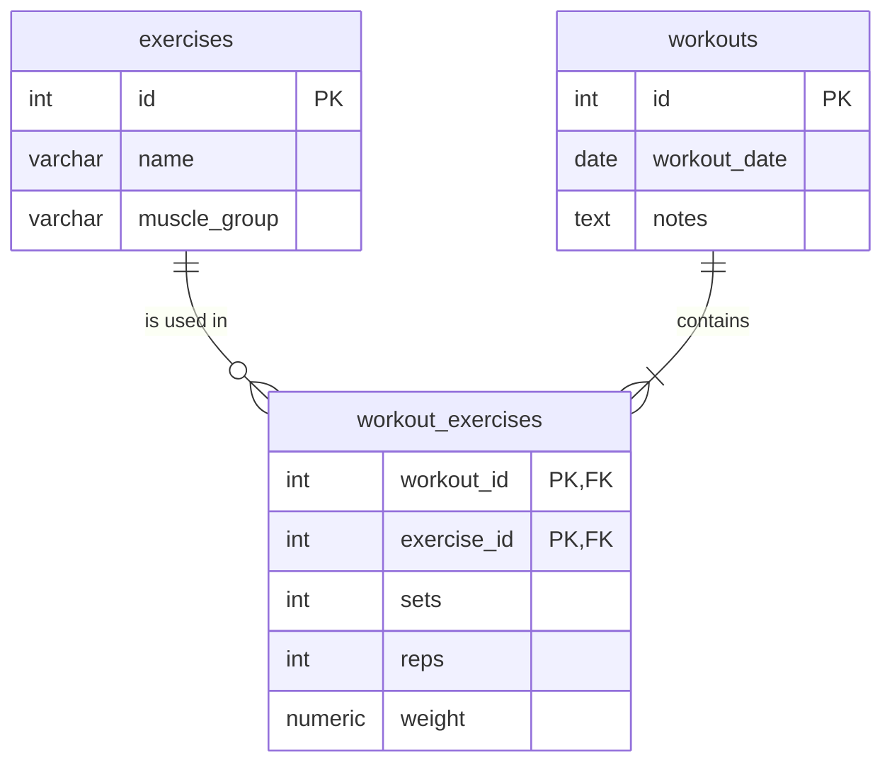

# Training Journal

Application web full stack de suivi d'entraînement sportif : on enregistre ses séances, les exercices réalisés, le nombre de séries, de répétitions et la charge utilisée.

Premier projet full stack.

---

## Stack technique

| Couche | Dossier | Technologie |
|---|---|---|
| Présentation (front) | `trainingJournal_presentation` | React + Vite |
| Métier (back / API) | `trainingJournal_business` | Node.js + Express |
| Données (BDD) | `trainingJournal_data` | PostgreSQL |

---

## Architecture : comment les couches sont reliées

Le projet suit une **architecture 3 couches**. Chaque couche ne parle qu'à sa voisine :

```
┌──────────────────────┐   fetch (HTTP/JSON)   ┌──────────────────────┐   requêtes SQL (pg)   ┌──────────────────────┐
│   React (Vite)       │ ────────────────────► │   Express (Node.js)  │ ────────────────────► │   PostgreSQL         │
│   presentation       │ ◄──────────────────── │   business           │ ◄──────────────────── │   data               │
│   localhost:5173     │      réponse JSON     │   localhost:3310     │     lignes (rows)     │   localhost:5432     │
└──────────────────────┘                       └──────────────────────┘                       └──────────────────────┘
```

### Lien 1 : Express ↔ PostgreSQL

Le back se connecte à la base grâce au package **`pg`**, qui crée un *pool* de connexions.

- Les identifiants sont stockés dans un fichier **`.env`** (jamais versionné) et chargés par **`dotenv`**.
- Le fichier **`db.js`** crée le pool à partir de ces variables et l'exporte.

```js
// trainingJournal_business/db.js
import pg from "pg";
import "dotenv/config";

const pool = new pg.Pool({
  host: process.env.DB_HOST,
  port: process.env.DB_PORT,
  user: process.env.DB_USER,
  password: process.env.DB_PASSWORD,
  database: process.env.DB_NAME,
});

export default pool;
```

Les routes utilisent ensuite `pool.query()` pour interroger la base :

```js
// trainingJournal_business/index.js
app.get("/api/exercises", async (req, res) => {
  const { rows } = await pool.query("SELECT * FROM exercises ORDER BY id");
  res.json(rows);
});
```

### Lien 2 : React ↔ Express

Le front appelle l'API avec **`fetch`**, puis stocke la réponse dans un state React.

```jsx
// trainingJournal_presentation/src/App.jsx
useEffect(() => {
  fetch("http://localhost:3310/api/exercises")
    .then((res) => res.json())
    .then((data) => setExercises(data));
}, []);
```

Le front (port 5173) et le back (port 3310) n'ont pas la même origine. Le navigateur bloque donc les requêtes par défaut. Le back les autorise avec le middleware **`cors`** :

```js
app.use(cors({ origin: "http://localhost:5173" }));
```

---

## Modélisation de la base de données

### MCD


- Un exercice apparaît dans **0 ou plusieurs** séances.
- Une séance contient **1 ou plusieurs** exercices.

### MLD


- **exercises** (<u>id</u>, name, muscle_group)
- **workouts** (<u>id</u>, workout_date, notes)
- **workout_exercises** (<u>#workout_id</u>, <u>#exercise_id</u>, sets, reps, weight)

L'association N-N `CONTENIR` devient la table de liaison `workout_exercises`, avec une clé primaire composée des deux clés étrangères.



### MPD

Le script SQL complet se trouve dans [`trainingJournal_data/schema.sql`](./trainingJournal_data/schema.sql)

---

## Structure du projet

```
trainingJournal/
├── README.md
├── docs/                            # Schémas de la base
│   ├── mcd.png
│   └── mld.png
│
├── trainingJournal_data/            # Base de données
│   └── schema.sql                   # Création des tables + données de test
│
├── trainingJournal_business/        # API Express
│   ├── .env                         # Identifiants BDD (non versionné)
│   ├── .env.sample                  # Modèle du .env (versionné)
│   ├── db.js                        # Connexion à PostgreSQL
│   ├── index.js                     # Serveur + routes
│   └── package.json
│
└── trainingJournal_presentation/    # Front React
    ├── src/
    │   └── App.jsx                  # Appel à l'API + affichage
    └── package.json
```

---

## Installation

### Prérequis

- [Node.js](https://nodejs.org/) (v20 ou plus)
- [PostgreSQL](https://www.postgresql.org/download/), avec `psql` accessible dans le terminal

 Sous Windows, si `psql` n'est pas reconnu, ajoute `C:\Program Files\PostgreSQL\<version>\bin` à la variable d'environnement `PATH`, puis rouvre le terminal.

### 1. Cloner le projet

```bash
git clone <url-du-depot>
cd trainingJournal
```

### 2. Base de données (`trainingJournal_data`)

**a. Créer un utilisateur et une base dédiés.** On se connecte en administrateur :

```bash
psql -U postgres
```

```sql
CREATE USER training_journal_user WITH PASSWORD 'ton_mot_de_passe';
CREATE DATABASE training_journal OWNER training_journal_user;
\q
```

> L'utilisateur est **propriétaire** de la base : il a donc tous les droits dessus, sans `GRANT` supplémentaire.
> Si la base existe déjà, on change son propriétaire :
> `ALTER DATABASE training_journal OWNER TO training_journal_user;`

**b. Créer les tables avec ce nouvel utilisateur.**

```bash
cd trainingJournal_data
psql -U training_journal_user -d training_journal -f schema.sql
```

Cette commande **lit** `schema.sql` et exécute son contenu dans la base. Le fichier, lui, n'est pas modifié. Le script commence par des `DROP TABLE IF EXISTS` : on peut donc le relancer autant de fois que nécessaire pour repartir d'une base propre.

**c. Vérifier.**

```bash
psql -U training_journal_user -d training_journal
```

```sql
\dt                       -- liste les tables
SELECT * FROM exercises;  -- affiche les données de test
\q
```

### 3. Back-end (`trainingJournal_business`)

```bash
cd ../trainingJournal_business
npm install
```

Créer un fichier **`.env`** à partir de `.env.sample` :

```env
PORT=3310
DB_HOST=localhost
DB_PORT=5432
DB_USER=training_journal_user
DB_PASSWORD=ton_mot_de_passe
DB_NAME=training_journal
```

> Pas d'espace autour du `=` et pas de guillemets.

Le `package.json` doit contenir `"type": "module"` (pour utiliser `import`) et le script de lancement :

```json
"scripts": {
  "dev": "node --watch index.js"
}
```

Lancer l'API :

```bash
npm run dev
```

Test : http://localhost:3310/api/exercises doit renvoyer la liste des exercices en JSON.

### 4. Front-end (`trainingJournal_presentation`)

Dans un **deuxième terminal**, l'API devant rester lancée :

```bash
cd trainingJournal_presentation
npm install
npm run dev
```

 Test : http://localhost:5173 affiche la liste des exercices venant de la base.

> Le projet a été initialisé avec `npm create vite@latest . -- --template react`.

---

## Lancer le projet au quotidien

| Terminal 1 : API | Terminal 2 : Front |
|---|---|
| `cd trainingJournal_business` | `cd trainingJournal_presentation` |
| `npm run dev` | `npm run dev` |

PostgreSQL tourne en tâche de fond, en tant que service Windows.

---

## Routes de l'API

| Méthode | Route | Description |
|---|---|---|
| GET | `/api/exercises` | Liste de tous les exercices |

---

## 🩹 Problèmes rencontrés et solutions

| Erreur | Cause | Solution |
|---|---|---|
| `npm error JSON.parse Unexpected end of JSON input` | `package.json` vide | Supprimer le fichier et relancer `npm init -y` |
| `'next' n'est pas reconnu` | Script `dev` copié d'un projet Next.js | Remplacer par `node --watch index.js` |
| `ReferenceError: app is not defined` | Imports et `const app = express()` manquants | Ajouter le début du fichier `index.js` |
| `Cannot GET /` | Aucune route définie sur `/` | Aller sur `/api/exercises` |
| `password authentication failed` | Mauvais mot de passe dans `.env` | Vérifier `DB_PASSWORD` |
| `relation "..." does not exist` | Nom de table différent entre le code et la base | Vérifier avec `\dt` dans psql |
| Erreur **CORS** dans la console | Le back n'autorise pas l'origine du front | `app.use(cors({ origin: "http://localhost:5173" }))` |
| `.gitignore` ignoré par Git | Fichier nommé `gitignore`, sans le point | `mv gitignore .gitignore` |

---

## Prochaines étapes

- [ ] Routes `POST`, `PUT`, `DELETE` (CRUD complet)
- [ ] Routes pour les séances (`/api/workouts`)
- [ ] Découpage du back en `routes/` et `controllers/`
- [ ] Formulaires d'ajout côté front

---

## 👤 Auteur

**François Dumele** ([Xodia](https://github.com/Xodia-stack))
